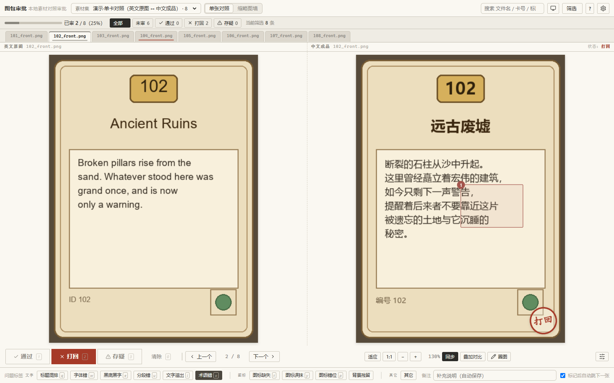
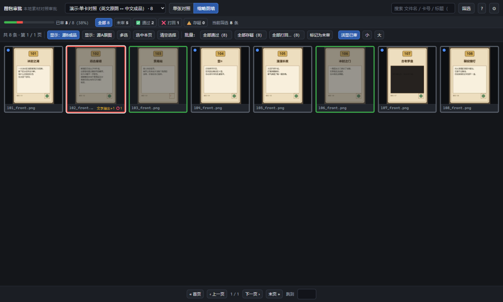

# 图包审批工具 · Asset Approval Tool

本地跑的**素材对照审批工具**：左边源A、右边源B 并排看，一键标记 ✅通过 / ❌打回 / ⚠️存疑，
打回时点问题标签、在图上圈出问题位置，结果实时写盘、可导出 JSON + CSV 给下游程序读。

**最初为 [TTS](https://www.tabletopsimulator.com/)（桌游模拟器）图包的开发与本地化审批而设计**
——比如「英文原版图包 ↔ 中文本地化成品」「上一版渲染 ↔ 新一版渲染」的对照验收——
但工具本身与语言、与项目无关，**任何需要两组素材并排审批的场景都能用**：
游戏贴图校对、UI 切图验收、设计稿版本对比、文档翻译审定、3D 模型对照，等等。
图片、文本、3D 模型（OBJ）三种素材类型都支持。

> **English**: A local, offline web tool for reviewing two sets of assets side by side
> (source A vs. source B — any pair you configure). Originally built for
> **Tabletop Simulator (TTS) mod/asset-pack development and localization** review,
> but works for any two-set comparison: game textures, UI slices, design iterations,
> translated documents, OBJ models. Mark pass/reject/unsure, tag problems, draw boxes
> on images, batch-operate, export machine-readable results. Ships with a demo
> dataset — clone and run. Speaks **MCP** and has a **CLI** so AI agents can drive
> the review loop directly.

- 纯本地运行，**不联网**，不需要数据库
- 克隆下来直接跑，自带合成演示素材
- 上千张素材不卡（缩略图懒加载 + 磁盘缓存 + 指纹失效）
- 结果实时落盘，关掉浏览器不丢，支持断点续审
- 三种驱动方式：**网页界面** / **命令行** / **MCP**（给 AI agent）
- 素材重渲后自动识别哪些结论已过期；不同渲染批次可以派生成互相隔离的集合





---

## 一、快速开始

```bash
git clone https://github.com/Smirk1921/asset-approval-tool.git
cd asset-approval-tool
pip install -r requirements.txt
python app.py
```

浏览器会自动打开 <http://127.0.0.1:8765/>。Windows 上也可以直接双击 **`启动.bat`**。

仓库自带一套**合成演示素材**（`demo/`，8 张卡片 + 12 条文本槽位），其中 5 张的成品
故意做了缺陷——文字溢出、图标缺失、标题混排、文字重叠、黑底黑字。打开就能上手试，
不用先准备自己的素材。

要换成自己的素材：改 `config.json` 里的路径，或者复制 `config.example.json` 改一份，
`python app.py --config 你的配置.json`。**代码里没有任何写死的路径。**

常用参数：

```bash
python app.py --config 别的配置.json     # 换一份配置文件
python app.py --port 8800                # 换端口
python app.py --no-browser               # 不自动开浏览器
python app.py --restart                  # 先停掉占用该端口的旧实例再启动
python app.py --probe                    # 只探测该端口有没有本工具在跑（在跑退出码 3）
```

---

## 二、界面怎么用

### 单张对照

图片素材：左边**源A**、右边**源B**，同步缩放平移。滚轮缩放、按住拖拽平移、
双击在「适应窗口 / 原始大小」之间切换。文本素材：左右分栏显示原文 / 译文，
可切上下分栏、调字号、开同步滚动。3D 模型素材（OBJ）：左右各一个 WebGL 视口，
拖拽旋转、滚轮缩放、Shift+拖拽平移，可一键同步两侧相机。

### 一键标记 + 问题标签

点 **✅通过 / ❌打回 / ⚠️存疑**，或直接按 `1` `2` `3`。**每次操作立刻写盘**。

标签也能用键盘：标签上写着各自的键（默认 `Q W E T Y U I O P` 对应前 9 个）。
**按一下 = 打回 + 贴这个标签**，一张卡可以连按几个再按 `→` 走人。

### 对照看图

**叠加对比**（按 `X`）：把两侧素材叠在同一张上，有两种模式：

- **滑块对比**：拖中间那条竖线决定左右各露多少，一眼看出哪里多字、少字、错位。
- **半透明叠加**：源B 以可调透明度盖在源A 上，滑块控制 0~100%。

按住**空格**临时看全幅源A。两侧分辨率不同时会自动统一显示尺寸，保证逐像素对得上。

### 圈图标注

点 **✏️ 圈图**（或按 `R`），在图上拖拽画框，**右侧栏自动弹出并定位到这条圈选的输入框**，
直接打字就行；按 Enter 或失焦后侧栏自动收回。可以圈多处。

在缩略图墙上把鼠标移到某张卡上，右下角出现 ✏️，点它**直接进这张的圈注模式**；
画完按 `Esc` 退出会自动回到墙上刚才那张。

圈选框按**图片比例**保存（0~1 的相对值），换窗口大小、缩放都不影响；
导出时给下游的也是相对坐标，「CSV（圈注明细）」还会同时给出像素坐标。

### 缩略图墙

一屏扫过去，边框颜色标状态：灰=未审、绿=通过、红=打回、黄=存疑、**黄色虚线=源文件已变**。
未审的左上角有蓝点，已审的默认淡显（可关），所以「还剩哪些没看」一眼能扫出来。

### 筛选与搜索

- 快捷按钮带条数：全部 / 未审 / 通过 / 打回 / 存疑，一眼看到还剩多少没审。
- **筛选**：状态 + 属性（分组、类型、扩展…）+ 问题标签组合筛选，另有几个特殊条件：
  **未打任何标签**、**有圈选**、**有备注**、**源文件已变**、**打回且无标签**。
- 搜索框：按文件名、素材 id、卡号、标题模糊搜。

### 批量操作

对**当前筛选结果**一键标记，**按钮上直接写着会作用到多少条**，执行前弹确认框，
执行后提示条里有 **撤销**。在缩略图墙点 **多选** 可以只作用于勾选的那些。

「清除审批…」把所选素材还原到未审，**状态、标签、备注、圈选一并清空**（二次确认，
9 秒内可撤销）。批量清除是原子操作：要么全部生效、要么全部不生效。

### 集合与批次

- 顶栏 **素材集** 下拉随时切换；当前集合会写进网址（`?set=xxx`），刷新和分享链接都停在同一个集合。
- **派生新集合…**：从当前集合派生出独立的新集合——可以换成品目录（重渲后的新目录），
  也可以只包含当前筛选出的那几张。**不用把文件拷来拷去，也不用改配置文件**。
- **归档本轮，开始新一轮…**：同一批素材重审时，把当前结果存档、批次清空、轮次 +1；
  下一轮点 **筛出上轮打回的** 优先复审。
- 改了 `config.json` 后不用自己想起刷新：页面会提示「配置已更新」，点一下就重载。

### 源文件被重渲了怎么办

审批结果会记下**审批那一刻源文件的指纹**。重渲完素材后**只要刷新浏览器（F5）**，
工具就会自己发现，并提示：

```
⚠ 有 31 条素材在你审批之后源文件又被改过（重渲过），这些结果可能已经过期。
```

然后你可以：**只看这些** / **清除它们的结果，重新审** / **忽略**。
在单张对照视图里，这样的素材右侧会直接标出「⚠ 审批后已被改过，此结论可能过期」，
并给一个 **清除结论，重新审** 按钮，不用翻回列表去找。
统计条上也会多出一个 **⚠ 需复审 N** 的快捷筛选。

> 想让它全自动（源一变就把结论清成未审）可以在配置里设 `"auto_reset_stale": true`。
> 默认是关的：静默清掉已经下过的结论风险太大，工具默认只提示、由你决定。

没被改过的素材结果照旧保留，不会被误清。图片 URL 里也带了同一个指纹，
所以浏览器必定拉新图，不用 Ctrl+Shift+R。文本素材集同理：改了译文 JSON，刷新就能看到。

### 轮次归档

审完一批想留档、然后在同一批素材上开新轮：

- **归档本轮，开始新一轮…** —— 当前结果整体存成 `results/<素材集>.roundN.json`，
  当前批次清空、轮次 +1，缩略图缓存一并清掉。
- **筛出上轮打回的** —— 下一轮开始时点它，直接筛出上一轮所有打回的素材，优先复审。

### 导出

- **JSON**：完整结构，含圈选坐标、标签、备注、审批时间，给程序读。
- **CSV**：表格，带 BOM，Excel 双击直接打开不乱码。
- **CSV（圈注明细）**：**每处圈选单独一行**，坐标同时给百分比和像素，下游可直接定位修复。
- **修正建议（JSON）**：把打回原因按标签展开成"下一步该怎么改"的清单，话术由你在配置的
  `tag_advice` 里定义，工具只负责贴出来。
- **导出圈选裁剪（ZIP）**：把每处圈注的矩形从原图上裁出来打包——圈出"这里缺个图标"，
  导出的就是现成的抠图素材。

字段含义见 [`docs/审批结果字段说明.md`](docs/审批结果字段说明.md)。

---

## 三、快捷键

| 键 | 作用 |
|---|---|
| `←` `→` / `A` `D` | 上一个 / 下一个 |
| `1` `2` `3` | 通过 / 打回 / 存疑 |
| `0` | 清除标记（回到未审） |
| `Q W E T Y U I O P` | 贴上对应的前 9 个问题标签（没审过的会顺手置成打回） |
| `V` / `G` | 单张对照 / 缩略图墙 |
| `R` / `X` | 圈图模式 / 叠加对比 |
| `F` / `Z` / `S` | 适应窗口 / 原始大小 / 左右同步 |
| `空格`（叠加模式下） | 临时看全幅源A |
| `/` | 跳到搜索框 |
| `Ctrl+Z` / `Esc` | 撤销上一步 / 退出圈图或关闭弹窗 |

键位在 `shortcuts` 里改，标签键位在 `tag_shortcuts` 里改，改完点 ⚙ →「重新扫描配置」
即时生效不用重启。标签键和别的键撞车时，启动会直接提示改哪几个。

---

## 四、给 AI agent 用

这个工具不只是给人点的——agent 也能直接驱动它，形成「agent 看素材 → 判断 → 写结论 → 给人复核」
的闭环。典型的用法是让视觉模型先做一轮**机器预审**，人只复核拿不准的那些；或者把已审过的
批次重渲后，让 agent 只针对"源文件变了"的那些重新审。

agent 有三条通路可以选，**语义完全一致**：

| 通路 | 什么时候用 |
|---|---|
| **MCP**（`mcp_server.py`） | **首选**。工具直接出现在 agent 的工具列表里，图片可以作为 MCP image content 块返回给模型直接看 |
| **CLI**（`agent.py`） | 没有 MCP 宿主时；每次调用输出一个 JSON，适合 shell 脚本和 workflow 编排 |
| **HTTP**（`app.py` 起的服务） | 用户正在网页上审批时，走这条和用户共用同一份状态，互不覆盖 |

**服务在跑就走 HTTP、没跑就直接读写文件**——这条规则 CLI 和 MCP 都自动生效，不用手动选。
原因：网页版把结果缓存在内存里，如果在服务运行时直接改文件，改动会被覆盖。

### 4.1 MCP 接入（推荐）

在 agent 宿主（Claude Code、ZCode 等）的配置里加：

```json
{
  "mcpServers": {
    "asset-approval": {
      "command": "python",
      "args": ["/绝对路径/mcp_server.py"]
    }
  }
}
```

宿主启动后，14 个工具直接可用：

| 工具 | 用途 |
|---|---|
| `approval_status` | 总览所有素材集：条数、各状态数量、过期条数、当前轮次。**开工前必调** |
| `list_items` | 列素材，可按状态 / 标签 / 分组 / 搜索 / 过期 / 有圈选 / 有备注等组合筛 |
| `get_item` | 单条素材的完整信息（图片路径或文本正文 + 已有审批结果 + 圈选明细） |
| `get_item_images` | **把图片本身返回给模型看**（MCP image content 块）。`stitch=true` 拼成左右对照图 |
| `review_item` | 给一条素材写审批结果（状态 + 标签 + 备注 + 圈选） |
| `batch_review` | 一次写回多条，**全部校验通过才落盘**（原子写，不会写一半） |
| `export_results` | 导出 JSON / CSV / 圈注明细 / 修正建议 |
| `clear_stale_results` | 清掉"源文件已变"的过期结果，让它们回到未审 |
| `start_new_round` | 归档本轮结果并开始新一轮（**慎用**：会清空当前批次） |
| `list_previous_round_rejects` | 上一轮所有打回的素材 id，用于优先复审 |
| `export_crops` | 把每处圈选从原图裁出，打包成 ZIP（下游抠图素材） |
| `lookup_item` | 跨集合查一个素材 id 的所有历史结论（"这张卡上一轮是什么结论？"） |
| `compare_sets` | 对比两个集合里同一批素材的结论差异（"上轮打回的这轮修好了没？"） |
| `derive_set` | 从当前集合派生出隔离的新集合（重渲后的批次单独审，不污染旧结果） |

**视觉模型看图强烈推荐 `get_item_images(stitch=true)`**：它把源A 和源B 拼成**一张**对照图
（左源A、右源B，已按同一尺寸对齐），模型一次性吃下。原因：

- 很多模型一次只能吃一张图，得靠两次调用 + 文字描述去对齐——图标位置、分段间距、
  字体差异这些信息靠文字根本描述不清。
- 即使模型能吃多张，给它一张已经对齐好的对照图也比给两张原图准——否则它得自己
  在内部对齐，出错率高。

`stitch_layout: "vertical"` 可改成上下拼接；`draw_annotations: true` 会把已有圈选框
画到拼图上（用于"上一轮圈出的问题现在修没修"的复核）。

### 4.2 CLI 用法

`agent.py` 是命令行版本，每次调用输出**一个** JSON，适合 shell 脚本和 workflow 编排：

```bash
# 总览 / 列表 / 详情
python agent.py status
python agent.py items --set demo_cards --status unreviewed --limit 20
python agent.py item  --set demo_cards --id 102_front.png

# 单条审批：状态 + 标签 + 备注 + 圈选一次给全
python agent.py review --set demo_cards --id 102_front.png --status 打回 \
    --tags 文字溢出 --note "正文超出文本框" \
    --annotate "0.09,0.55,0.82,0.28,b,正文溢出到框外"

# 拼对照图（agent 自己拿去送视觉模型）
python agent.py image-pair --set demo_cards --id 102_front.png --out pair.png
python agent.py image-pair --set demo_cards --filter-status unreviewed --out-dir pairs/

# 批量写回（原子：全部校验通过才写）
python agent.py review-batch --set demo_cards --file reviews.json --dry-run  # 先预演
python agent.py review-batch --set demo_cards --file reviews.json            # 真跑

# 批量改状态（必须显式指定范围，防止"都通过"刷掉整个素材集）
python agent.py batch --set demo_cards --filter-status unreviewed --status pass --dry-run
python agent.py batch --set demo_cards --filter-status all --status "" --yes  # 清空所有

# 导出
python agent.py export --set demo_cards --format json --out 结果.json
python agent.py export --set demo_cards --format annotations --only problem --out 问题清单.csv
python agent.py export --set demo_cards --format advice --out 修正建议.json
python agent.py export-crops --set demo_cards --zip 圈选裁剪.zip

# 集合管理
python agent.py derive-set --from-set demo_cards --new-id demo_v2 \
    --only-ids 101_front.png,103_front.png
python agent.py drop-set --set demo_v2 --yes
python agent.py clear-stale --set demo_cards
python agent.py new-round --set demo_cards --yes
python agent.py prev-round --set demo_cards

# 跨集合查询
python agent.py lookup --set demo_v2 --id 101_front.png
python agent.py compare --set demo_cards --other demo_v2

# 列出预设的审批模板与标签
python agent.py templates
```

每条命令的退出码：`0` 成功，`1` 业务错误（JSON 里有 `error` 字段说明怎么改），
`2` 参数错误。

### 4.3 为 agent 做的专门设计

- **自动选路**：CLI 启动时探测 `data/app.pid`——pid 文件有效且端口能通就走 HTTP，
  否则直接读写文件。服务跑在非默认端口时会给出提示；真要用 `--offline` 直连写而
  被拦下来，说明服务正在跑，加 `--force` 才能强行覆盖。
- **原子批量写**：`batch_review` / `review-batch` 先把所有条目校验完（id 存在、
  状态合法、标签在预设词表内、坐标在 0~1 内），**全部通过才落盘**；任何一条失败，
  整个批次不写，返回的 `failures` 数组逐条说明原因。
- **批量必须给范围**：`batch` 不给 `ids` 也不给筛选条件会直接报错。想作用于全部要
  显式写 `filter_status="all"`。防的是「一句都通过刷掉整个素材集」。
- **`dry_run` 预演**：所有写操作都支持 `--dry-run`，先看会命中哪些、共几条，再决定执行。
- **标签纠错**：写成"图标丢失"这种同义词会被拦下并提示"是不是要写『图标缺失』"
  （`suggest_tag` 用编辑距离 + 最长公共子序列找最接近的预设词）。避免标签写花了
  之后筛不出来。
- **中英文都认**：`pass` / `通过` 等价，`unreviewed` / `未审` 等价。MCP 工具描述
  也是中文写的，模型直接读懂。
- **错误可读**：失败时返回 `{"ok": false, "error": "……"}`，直接说明怎么改，
  不会让 agent 反复试错。
- **拿不准就 `flag`**：工具的指引（`AGENTS.md`）里明确写了「拿不准就 flag，不要
  猜着 pass」，因为 pass 意味着"可以发布"，代价比打回大。
- **只传要改的字段**：`review_item` 没传的字段保持原值，agent 不用担心误清空。

### 4.4 文档

- [`AGENTS.md`](AGENTS.md) — **给 agent 的操作须知**：三条通路怎么选、标准审批流程、
  判断与写结论的规矩、安全红线（哪些操作必须二次确认）、迭代渲染时常用的工具组合。
- [`docs/agent-接口.md`](docs/agent-接口.md) — 完整接口参考：CLI / MCP / HTTP 三套
  参数和返回结构一一对应。
- [`docs/agent-工作流示例.md`](docs/agent-工作流示例.md) — 4 个可以直接照抄的完整流程：
  批量预审回写、派生隔离集、归档新轮、圈选裁剪导出。
- [`docs/审批结果字段说明.md`](docs/审批结果字段说明.md) — 结果 JSON/CSV 字段含义
  与 Python 读取示例。

---

## 五、配置文件

路径**全部写在 `config.json` 里**，代码里没有任何写死的路径。改完点 ⚙ →
「重新扫描配置」即可生效，配置文件会整个重读。

### 顶层

| 字段 | 说明 |
|---|---|
| `host` / `port` | 本地服务地址端口 |
| `data_dir` | 放审批结果和缩略图缓存的目录 |
| `tags` | 问题标签预设列表 |
| `tag_shortcuts` | 标签快捷键，按顺序对应 `tags` 的前几个 |
| `templates` | 常用标签组合，例如 `[{"id":"text_layout","name":"文字排版","tags":["文字溢出","分段错"]}]`；`review --template text_layout` 直接用 |
| `tag_advice` | 标签 → 修正建议话术，`export --format advice` 时展开成清单。**具体说什么由使用方定义，工具不含任何项目专属内容** |
| `auto_reset_stale` | `true` 时启动就把「源文件已变」的结果清成未审（默认 `false`，只提示不自动清） |
| `shortcuts` | 快捷键，值是按键数组，如 `"pass": ["1", "y"]` |
| `wall_page_size` | 缩略图墙每页几张，默认 60 |
| `auto_advance` | 是否默认勾选「标记后自动跳下一张」 |
| `thumb.max_size` / `quality` | 缩略图尺寸与 JPEG 质量 |

### 素材集（`sets` 数组）

| 字段 | 说明 |
|---|---|
| `id` | 唯一标识，也是结果文件名 |
| `name` | 界面上显示的名字 |
| `type` | `image` / `text` / `model` |
| `pair` | 配对方式，见下表 |
| `items_from` | 以哪一侧为准：`b`（只看有成品，推荐）/ `a` / `union` |
| `a` / `b` | 源A、源B。图片/模型是 `{"root": "目录", "label": "显示名"}`；文本可用 `{"kind":"json","path":"...","fields":[...],"label":"..."}` |
| `include` / `exclude` | 文件名通配符，默认排除 `_*`、`.*`、`~*` |
| `recurse` | 是否递归扫子目录（默认 true） |
| `id_regex` / `id_template` | 文本素材集里把 JSON 的长键变成好读的 id，如 `卡{card}-槽{row}-{col}` |
| `group_field` | 用元数据里的哪个字段当「分组」 |
| `meta` | 可选。清单文件，给素材补属性 |
| `only_ids` | 可选。素材白名单，只审这些 id（用来从大集合里"只看这批"，不必拷贝文件） |

> 派生出来的集合放在 `sets.d/*.json`，工具只写这个目录，**不会动你手写的 `config.json`**。
> 删掉文件就等于删掉集合。

### 三种配对方式（`pair`）

| 值 | 适用 | 说明 |
|---|---|---|
| `basename` | 图片、模型、文本文件 | 两个目录里**同名**的文件配成一对，可递归 |
| `manifest` | 图片、模型 | 清单里每条记录对应一张素材，文件名由 `key_template` 生成 |
| `json_key` | 文本 | 源A / 源B 各是一个 JSON，按**顶层键**配对 |

`basename` 例子（原图放扁平目录、成品按类型分子目录，靠文件名对齐）：

```json
{
  "id": "my_cards",
  "name": "单卡对照（原图 ↔ 成品）",
  "type": "image",
  "pair": "basename",
  "items_from": "b",
  "a": { "root": "D:/素材/原图", "label": "原图" },
  "b": { "root": "D:/素材/成品", "label": "成品" },
  "include": ["*_front.png", "*_back.png"],
  "exclude": ["_*", ".*"],
  "recurse": true,
  "meta": {
    "path": "D:/素材/清单.json",
    "join": "filename",
    "key_template": "{card_id}_front.png",
    "id_field": "card_id",
    "fields": ["卡号", "类型", "扩展", "状态", "英文标题"],
    "facets": ["类型", "扩展"]
  }
}
```

3D 模型素材（OBJ）的例子：

```json
{
  "id": "my_models",
  "name": "模型对照（白模 ↔ 贴图版）",
  "type": "model",
  "pair": "basename",
  "items_from": "b",
  "a": { "root": "D:/素材/白模", "label": "白模" },
  "b": { "root": "D:/素材/贴图版", "label": "贴图版" },
  "include": ["*.obj"]
}
```

### 元数据（`meta`）

| 字段 | 说明 |
|---|---|
| `path` | 清单文件（JSON 数组，或「键→记录」的对象） |
| `join` | 怎么和素材对上：`filename`（按文件名）/ `key`（按 JSON 键） |
| `key_template` | 用记录里的字段拼出文件名，如 `{card_id}_front.png` |
| `id_field` | `pair: manifest` 时，用哪个字段当素材 id |
| `name_field` | 可选，用哪个字段当显示名 |
| `fields` | 要在界面上显示哪些字段 |
| `rename` | 字段改名，如 `{"cat": "分类"}` |
| `facets` | 哪些字段做成筛选下拉框；写 `[]` 表示都不要。不写则自动选（取值种类 ≤30 的才做） |

### 文本来源的 `fields` 取值语法

| 写法 | 含义 |
|---|---|
| `"zh"` | 普通字段 |
| `"lines"` | 数组，元素直接拼起来 |
| `"lines[].t"` | 对象数组，取每个元素的 `t` 字段 |

多个字段按顺序用换行拼接。

---

## 六、目录结构

```
├── app.py                    网页版服务入口
├── agent.py                  命令行接口（给 AI agent / 脚本）
├── mcp_server.py             MCP 服务（stdio，无额外依赖）
├── config.json               当前配置（指向自带的 demo 素材）
├── config.example.json       配置模板，含四种素材集写法示例
├── core/
│   ├── config.py             配置读取与校验（含 sets.d 合并）
│   ├── materials.py          素材扫描与配对、源文件指纹
│   ├── results.py            审批结果读写 / 导出 / 轮次归档
│   ├── thumbs.py             缩略图生成与缓存
│   ├── images.py             对照图拼接、圈注裁剪
│   ├── agent_common.py       状态/标签/圈选规范化（两条通路共用）
│   ├── agent_ext.py          扩展能力：拼接/裁剪/批量写回/派生集合/跨集合查询
│   └── agent_api.py          操作层：HTTP 与直连两套实现
├── static/                   前端（原生 JS，含自研 WebGL OBJ 查看器，无外部依赖）
├── demo/                     合成演示素材（可重新生成）
│   └── generate_demo.py
├── sets.d/                   派生集合（工具自动生成，可 gitignore）
├── docs/
│   ├── agent-接口.md         命令行 / MCP / HTTP 接口参考
│   ├── agent-工作流示例.md    几个可以直接照抄的完整流程
│   ├── 审批结果字段说明.md     结果 JSON/CSV 字段说明
│   └── screenshot-*.png
├── AGENTS.md                 给 AI agent 的操作须知
├── data/                     运行后生成（已 gitignore）
│   ├── app.pid
│   ├── results/              审批结果 + history 流水 + 轮次归档
│   └── thumbs/               缩略图缓存
├── 启动.bat / 启动.sh
└── requirements.txt
```

---

## 七、常见问题

**端口被占用**：`python app.py --port 8800`；如果是上一个没关掉的工具实例，
`python app.py --restart` 直接接管。`python app.py --probe` 可以查它是否还在跑。

**服务会不会被误关**：`启动.bat` / `启动.sh` 会做三件事——已在运行时不重复起第二个
（两个实例会互相覆盖结果）、进程被意外杀掉 3 秒后自动拉起（最多 20 次）、
把 PID 写到 `data/app.pid` 供外部查询。双击启动的那个黑窗口要一直开着。

**素材没扫出来 / 数量不对**：看启动日志里该素材集的条数和警告；确认 `include` /
`exclude` 通配符、`recurse` 设置，以及 `items_from` 选的是哪一侧。

**重渲了素材要不要重审**：不用手动处理。刷新浏览器后工具会自己比出哪几条源文件变了
（见上面「源文件被重渲了怎么办」），只影响真被改过的那些。

**想清缩略图缓存**：⚙ → 清空缩略图缓存；「归档本轮」时也会自动清。

**审批结果会不会被误删**：结果文件损坏时不会被静默清空，会改名存一份
`<id>.bad-<时间>.json` 再重来。

---

## 八、依赖与许可

- Python 3.10+，依赖只有 **Flask** 和 **Pillow**（`pip install -r requirements.txt`）
- 前端是原生 JS，3D 模型查看器是自研的 WebGL OBJ 解析器（不依赖 three.js），完全离线
- 许可：[MIT](LICENSE)
